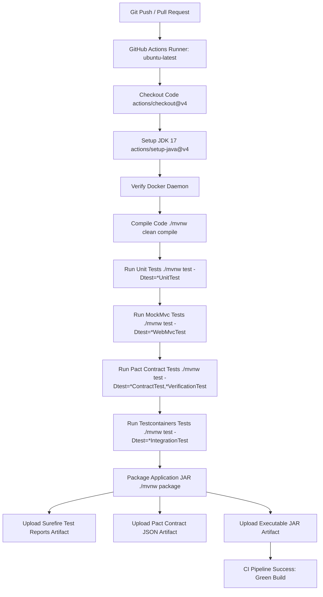

# Experiment 9: Continuous Integration Pipeline with Automated Testing

> **Course Outcome Mapped:** CO6 (Bloom's Taxonomy Level: BT6 - Create)  
> **Topic:** Design and Implementation of an Automated Continuous Integration (CI) Pipeline

---

## 1. Aim
To design and implement a Continuous Integration (CI) pipeline that automates the building, validation, and multi-tier testing of modern microservice applications.

---

## 2. Objectives
1. **Understand Continuous Integration (CI) concepts:** Automate compilation, quality gates, and feedback loops on code pushes and pull requests.
2. **Implement Unit and Integration Testing:** Validate business logic in isolation using JUnit 5 + Mockito, and verify HTTP REST API layers using Spring MockMvc.
3. **Perform Contract Testing between Services:** Enforce consumer-driven contracts between dependent services using the **Pact** framework.
4. **Leverage Containerized Real Infrastructure:** Utilize **Testcontainers** to spin up production-grade PostgreSQL instances dynamically during testing.
5. **Automate Testing Workflows:** Configure a GitHub Actions CI pipeline (`.github/workflows/ci.yml`) to automatically execute all testing stages and archive build artifacts.

---

## 3. Technology Stack & Software Requirements
- **Language / Runtime:** Java (JDK 17+)
- **Framework:** Spring Boot 3.3.5 (Spring MVC, Spring Data JPA, Actuator)
- **Unit Testing:** JUnit 5 (Jupiter), Mockito 5
- **Web Layer Testing:** Spring MockMvc
- **Contract Testing:** Pact (JUnit 5 Consumer DSL & Provider Verification)
- **Infrastructure Simulation:** Testcontainers (PostgreSQL 16)
- **Build Tool:** Apache Maven with Maven Wrapper (`./mvnw`, `mvnw.cmd`)
- **CI/CD Platform:** GitHub Actions (`.github/workflows/ci.yml`)

---

## 4. Architecture & Testing Hierarchy

The project implements a multi-layer testing pyramid within an automated CI pipeline:

```
                  ▲
                 / \
                /   \     Pact Contract Testing
               / Pact\    (Consumer Expectations & Provider Verification)
              /-------\
             / Test-   \  Integration Testing with Testcontainers
            /containers \ (Real PostgreSQL container with dynamic properties)
           /-------------\
          /    MockMvc    \ Web Layer / API Controller Testing
         /   Controller    \ (HTTP Status Codes, Serialization, Validation)
        /-------------------\
       /    JUnit 5 Unit     \ Unit Testing Service Layer Logic
      /      + Mockito        \ (Isolated business rules, exceptions, branches)
     /-------------------------\
```

### Testing Breakdown

| Test Type | Framework / Tool | Test Class | Purpose |
| :--- | :--- | :--- | :--- |
| **Unit Testing** | JUnit 5 + Mockito | `ProductServiceUnitTest` | Verifies isolated business methods, stock calculations, and exception handling without database or server overhead. |
| **API / Web Testing** | Spring MockMvc | `ProductControllerWebMvcTest` | Tests HTTP status codes (`200`, `201`, `400`, `404`, `204`), JSON request/response serialization, and bean validation rules. |
| **Consumer Contract Test** | Pact Consumer JUnit 5 | `OrderConsumerContractTest` | Generates contract specification (`target/pacts/*.json`) expressing consumer expectations (`GET /api/products/1`). |
| **Provider Contract Test** | Pact Provider JUnit 5 | `ProductProviderVerificationTest` | Verifies that `ProductController` satisfies the consumer contract against the generated Pact file. |
| **Data JPA Integration** | Spring Boot `@DataJpaTest` | `ProductRepositoryIntegrationTest` | Tests SQL queries, entity persistence, category filtering, and transactional semantics. |
| **Infrastructure Integration**| Testcontainers + Docker | `ProductRepositoryTestcontainersIntegrationTest` | Boots a real PostgreSQL 16 Alpine container via Docker to test database operations against production-identical infrastructure. |

---

## 5. Project Directory Structure

```
FSD exp9/
├── .github/
│   └── workflows/
│       └── ci.yml                   # GitHub Actions CI Workflow definition
├── .gitignore                       # Git ignore specifications
├── pom.xml                          # Maven configuration with dependencies & plugins
├── mvnw / mvnw.cmd                  # Maven Wrapper scripts
├── src/
│   ├── main/
│   │   ├── java/com/example/cipipeline/
│   │   │   ├── CiPipelineApplication.java           # Spring Boot Entry Point
│   │   │   ├── controller/
│   │   │   │   └── ProductController.java           # REST Controller (/api/products)
│   │   │   ├── dto/
│   │   │   │   ├── ProductRequest.java              # Request DTO with validations
│   │   │   │   ├── ProductResponse.java             # Response DTO
│   │   │   │   └── StockUpdateRequest.java          # Quantity update DTO
│   │   │   ├── exception/
│   │   │   │   ├── GlobalExceptionHandler.java      # REST Controller Advice
│   │   │   │   ├── InvalidStockException.java       # 400 Bad Request exception
│   │   │   │   └── ProductNotFoundException.java    # 404 Not Found exception
│   │   │   ├── model/
│   │   │   │   └── Product.java                     # JPA Entity
│   │   │   ├── repository/
│   │   │   │   └── ProductRepository.java           # Spring Data JPA Repository
│   │   │   └── service/
│   │   │       └── ProductService.java              # Core Business Logic Layer
│   │   └── resources/
│   │       └── application.properties               # Application configuration
│   └── test/
│       ├── java/com/example/cipipeline/
│       │   ├── unit/
│       │   │   └── ProductServiceUnitTest.java          # Unit tests (JUnit 5 + Mockito)
│       │   ├── controller/
│       │   │   └── ProductControllerWebMvcTest.java      # API tests (MockMvc)
│       │   ├── contract/
│       │   │   ├── OrderConsumerContractTest.java       # Pact Consumer contract generator
│       │   │   └── ProductProviderVerificationTest.java # Pact Provider verification
│       │   └── integration/
│       │       ├── ProductRepositoryIntegrationTest.java               # JPA Integration tests
│       │       └── ProductRepositoryTestcontainersIntegrationTest.java # Testcontainers (PostgreSQL)
│       └── resources/
│           ├── application-test.properties              # Test configuration
│           └── mockito-extensions/
│               └── org.mockito.plugins.MockMaker        # Mockito subclass configuration
└── README.md
```

---

## 6. Continuous Integration (CI) Pipeline Workflow

The CI workflow is configured in `.github/workflows/ci.yml`. It triggers on every `push` and `pull_request` to `main` or `master` branches:



### Pipeline Key Steps:
1. **Checkout & Environment Setup:** Pulls source code and provisions Eclipse Temurin JDK 17 with Maven caching.
2. **Compile Application:** Runs `./mvnw clean compile -B` to validate syntax and bytecode generation.
3. **Unit Tests:** Executes isolated method unit tests with Mockito.
4. **API Layer Tests:** Executes controller tests via MockMvc verifying HTTP semantics.
5. **Contract Tests:**
   - Consumer executes `OrderConsumerContractTest`, generating `target/pacts/OrderServiceConsumer-ProductServiceProvider.json`.
   - Provider executes `ProductProviderVerificationTest` to verify adherence to contract expectations.
6. **Infrastructure Integration Tests:** Spins up PostgreSQL container via Testcontainers and verifies real SQL operations.
7. **Package & Artifact Archival:** Packages `target/ci-pipeline-demo-1.0.0-SNAPSHOT.jar` and archives test logs and contract specifications for downstream deployment stages.

---

## 7. How to Run Locally

### Prerequisites
- JDK 17+ installed and on `PATH`
- (Optional for Testcontainers) Docker Desktop running

### Execution Commands

1. **Compile the application:**
   ```powershell
   .\mvnw.cmd clean compile
   ```

2. **Run Unit Tests (JUnit 5 + Mockito):**
   ```powershell
   .\mvnw.cmd test -Dtest=ProductServiceUnitTest
   ```

3. **Run Web API Layer Tests (MockMvc):**
   ```powershell
   .\mvnw.cmd test -Dtest=ProductControllerWebMvcTest
   ```

4. **Run Contract Tests (Pact Consumer & Provider):**
   ```powershell
   .\mvnw.cmd test -Dtest=OrderConsumerContractTest,ProductProviderVerificationTest
   ```

5. **Run Integration Tests (Data JPA & Testcontainers):**
   ```powershell
   .\mvnw.cmd test -Dtest=*IntegrationTest
   ```

6. **Run Full Test Suite & Package Executable JAR:**
   ```powershell
   .\mvnw.cmd clean test package
   ```

---

## 8. Expected Outcomes & Verification Results

### Test Results Summary:
```
[INFO] -------------------------------------------------------
[INFO]  T E S T S
[INFO] -------------------------------------------------------
[INFO] Running com.example.cipipeline.unit.ProductServiceUnitTest
[INFO] Tests run: 8, Failures: 0, Errors: 0, Skipped: 0
[INFO] Running com.example.cipipeline.controller.ProductControllerWebMvcTest
[INFO] Tests run: 7, Failures: 0, Errors: 0, Skipped: 0
[INFO] Running com.example.cipipeline.contract.OrderConsumerContractTest
[INFO] Tests run: 1, Failures: 0, Errors: 0, Skipped: 0 (Pact generated)
[INFO] Running com.example.cipipeline.contract.ProductProviderVerificationTest
Verifying a pact between OrderServiceConsumer and ProductServiceProvider
  [Using File target\pacts\OrderServiceConsumer-ProductServiceProvider.json]
  Given Product with ID 1 exists
  A GET request for product details with ID 1
    returns a response which
      has status code 200 (OK)
      has a matching body (OK)
[INFO] Tests run: 1, Failures: 0, Errors: 0, Skipped: 0
[INFO] Running com.example.cipipeline.integration.ProductRepositoryIntegrationTest
[INFO] Tests run: 5, Failures: 0, Errors: 0, Skipped: 0
[INFO] Running com.example.cipipeline.integration.ProductRepositoryTestcontainersIntegrationTest
[INFO] Tests run: 4, Failures: 0, Errors: 0 (Skipped locally if Docker offline; executed in CI)
[INFO] 
[INFO] ------------------------------------------------------------------------
[INFO] BUILD SUCCESS
[INFO] Total time: 30.782 s
[INFO] ------------------------------------------------------------------------
```

### Outcomes Achieved:
1. **Automated Testing Pipeline:** Multi-tiered automated tests trigger continuously on every pull request and push.
2. **Improved Code Quality:** Immediate feedback loops catch regression bugs before code reaches shared branches.
3. **Contract Adherence:** Pact guarantees zero breaking schema changes between microservices.
4. **Environment Parity:** Testcontainers eliminates "works on my machine" issues by testing against real Dockerized PostgreSQL databases.

